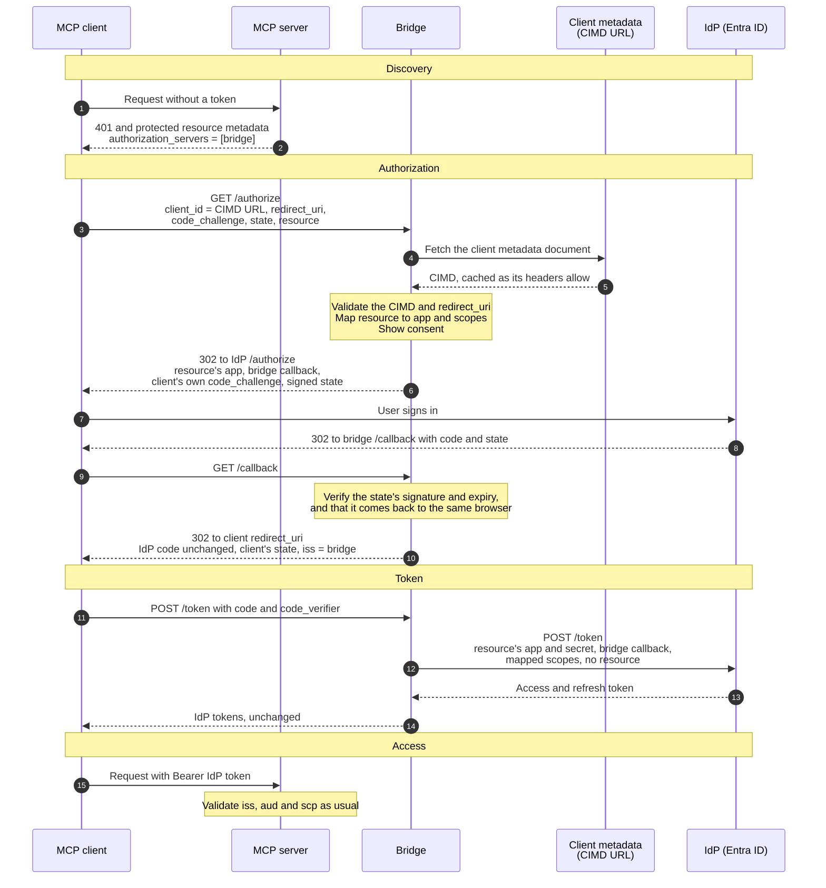

# entra-cimd-bridge

An OAuth authorization server that lets MCP clients sign in to MCP servers through an identity provider that doesn't speak the MCP authorization spec.

The [MCP authorization spec](https://modelcontextprotocol.io/specification/2025-11-25/basic/authorization) expects an authorization server that clients can use without prior registration: Client ID Metadata Documents (CIMD), PKCE advertised in metadata, and `resource` (RFC 8707). Entra ID, like most enterprise IdPs, offers none of that. The bridge sits in front of it. Towards MCP clients it is an authorization server with CIMD. Towards the IdP it is one confidential client per MCP server. In between it passes almost everything through: codes, PKCE, access tokens and refresh tokens are all the IdP's own, so MCP servers validate the IdP's tokens exactly as before.

## How it works



- **PKCE** is end to end: the client's challenge goes to the IdP, which binds its code to the client's verifier. The bridge never sees a verifier until it forwards one.
- **The only state** is what the bridge needs back at `/callback`: the client's redirect URI, state, client ID and resource. It travels in the IdP's `state` parameter, HMAC-signed and valid for 10 minutes. Without the signature anyone could pick where a code goes. The state is also bound to a cookie of the browser that started the sign-in, so a state minted in one browser can't take another person's code to its redirect URI.
- **Consent** is remembered in a signed cookie per client and MCP server, for `consent_ttl`.
- **CIMD documents** are cached in memory as their cache headers allow.
- **Isolation between MCP servers** comes from the IdP: every MCP server has its own app registration, and the bridge picks the credentials by `resource`. A code or refresh token issued to one server's app, sent with another server's `resource`, reaches the IdP with the wrong app and fails there with `invalid_grant`. The config refuses two resources sharing a `client_id`.

The bridge doesn't issue tokens of its own, has no database and doesn't proxy MCP traffic.

## Running

The bridge is a single static binary, published as `harbor.natron.services/natron-public/entra-cimd-bridge` (distroless) with a Helm chart in [`chart/`](chart).

```sh
docker run -p 8080:8080 -v ./config.yaml:/etc/bridge/config.yaml:ro \
  -e BRIDGE_KEY_CURRENT="$(openssl rand -base64 48)" \
  -e ENTRA_TENANT_ID=… -e CONTACTR_CLIENT_ID=… -e CONTACTR_CLIENT_SECRET=… \
  harbor.natron.services/natron-public/entra-cimd-bridge:latest
```

Replicas share nothing but the signing keys, so the bridge scales freely. With the chart, the configuration goes under `config:` in the values and the secrets into a Secret named by `existingSecret`, whose keys become environment variables.

`bridge --config config.yaml --check` validates the configuration, discovers every IdP and exits.

## Configuration

[`config.example.yaml`](config.example.yaml) is a complete example. `${NAME}` anywhere in a value is replaced by the environment variable, and an unset variable fails startup.

| Key | |
|---|---|
| `issuer` | The bridge's public URL, an https origin without a path. On a developer's machine it may be `http://localhost:<port>` |
| `listen`, `metrics_listen` | `:8080` and `:9090` by default. `/metrics` has its own listener, so it never faces the internet |
| `signing_keys` | Keys of at least 32 bytes for the state and the consent cookie. The first signs, all verify: to rotate, put a new key first and drop the old one after `consent_ttl` |
| `providers.<name>.issuer` | An IdP, loaded through OIDC discovery at startup. A provider that lists `code_challenge_methods_supported` without `S256` is refused; Entra lists none and supports S256 |
| `clients.cimd_hosts` | Hosts allowed to serve client metadata documents: a host, `*.domain`, or `*`. Claude's apps use `claude.ai`, Codex `chatgpt.com` and VS Code `vscode.dev` |
| `consent_ttl` | How long an approval is remembered per client and MCP server, `0` to ask every time |
| `resources` | One entry per MCP server: its canonical `uri`, a `name` for the consent page, the `provider`, the `client_id` and `client_secret` of its app registration, and the `scopes` to request |

The client's own `scope` is ignored: the bridge always requests the resource's configured scopes.

## Adding an MCP server

### In Entra

Use the MCP server's own app registration, since Entra lets an app request tokens for its own API, or a dedicated one with permissions on the server's API only. In it:

1. Add `https://<bridge>/callback` as a **Web** redirect URI.
2. Create a client secret for the bridge.
3. Make sure the delegated scope the bridge requests, such as `api://<client-id>/access_as_user`, is consented for the tenant, and that `requestedAccessTokenVersion` is 2.

Then add a `resources` entry with that app's client ID and secret. MCP clients never need their own registration.

### In the MCP server

The server serves Protected Resource Metadata (RFC 9728) that names the bridge, answers 401 with a challenge pointing to it, and validates the IdP's tokens as before: issuer, audience (its own API) and scope. The Go package [`resource`](resource/resource.go) does the first two:

```go
import "gitlab.com/natrontech/applications/entra-cimd-bridge/resource"

meta := &resource.Metadata{
	Resource:             "https://contactr.natron.ch/mcp", // exactly as in the bridge's config
	AuthorizationServers: []string{"https://mcp-auth.natron.ch"},
	ScopesSupported:      []string{"api://<client-id>/access_as_user"},
}
mux.Handle("GET "+meta.Path(), meta) // /.well-known/oauth-protected-resource/mcp

// In front of the MCP handler
token, ok := resource.BearerToken(r)
if !ok {
	meta.Challenge(w) // 401 with resource_metadata and scope
	return
}
if err := verifyEntraToken(r.Context(), token); err != nil {
	meta.InvalidToken(w, "The access token is invalid or expired.")
	return
}
```

## Clients

Any client with CIMD support works. These are tested against their published metadata documents ([`internal/cimd/clients_test.go`](internal/cimd/clients_test.go), `CIMD_LIVE=1` fetches the live ones):

| Client | `client_id` | Redirect | Signs in from |
|---|---|---|---|
| Claude Code | `https://claude.ai/oauth/claude-code-client-metadata` | `http://localhost:<port>/callback` | The user's machine |
| Claude Desktop, claude.ai, Claude mobile | `https://claude.ai/oauth/mcp-oauth-client-metadata` | `https://claude.ai/api/mcp/auth_callback` | Anthropic's servers |
| Codex | `https://chatgpt.com/oauth/codex/client.json` | `http://127.0.0.1:<port>/callback` | The user's machine |
| VS Code | `https://vscode.dev/oauth/client-metadata.json` | `http://127.0.0.1:33418/` or `https://vscode.dev/redirect` | The user's machine |

Claude Desktop runs its connectors from Anthropic's servers (`160.79.104.0/21`), not from the user's machine. For it, the MCP server and the bridge's metadata and token endpoints must be reachable from there, while `/authorize` and `/callback` only need to be reachable from the user's browser.

Codex uses its shared document because the bridge returns `iss` (RFC 9207). Without it, Codex would use one document per MCP server on the same host.

Clients must send `resource` on token requests when the bridge serves more than one MCP server, as the MCP spec requires. A bridge with a single MCP server uses it when `resource` is missing.

The MCP Go SDK (`modelcontextprotocol/go-sdk`, v1.8) refreshes through `golang.org/x/oauth2`, which can't add `resource`. Behind a bridge with several MCP servers its refreshes fail with `invalid_target`, unless the client passes a `NewTokenSource` that adds it, like [`e2e/e2e_test.go`](e2e/e2e_test.go) does.

## Development

```sh
make test   # unit tests and the end-to-end test, with the race detector
make lint   # golangci-lint 2.14 or newer
make run    # runs with ./config.yaml
```

Releases follow [Semantic Versioning](https://semver.org): pushing a tag like `0.2.0` publishes `harbor.natron.services/natron-public/entra-cimd-bridge:0.2.0` and the chart `oci://harbor.natron.services/natron-helm/entra-cimd-bridge` with the same version.

The end-to-end test in [`e2e/`](e2e) runs the official MCP Go SDK client through the bridge, against a fake IdP that binds codes and refresh tokens to apps like Entra and fake MCP servers that validate its JWTs.
