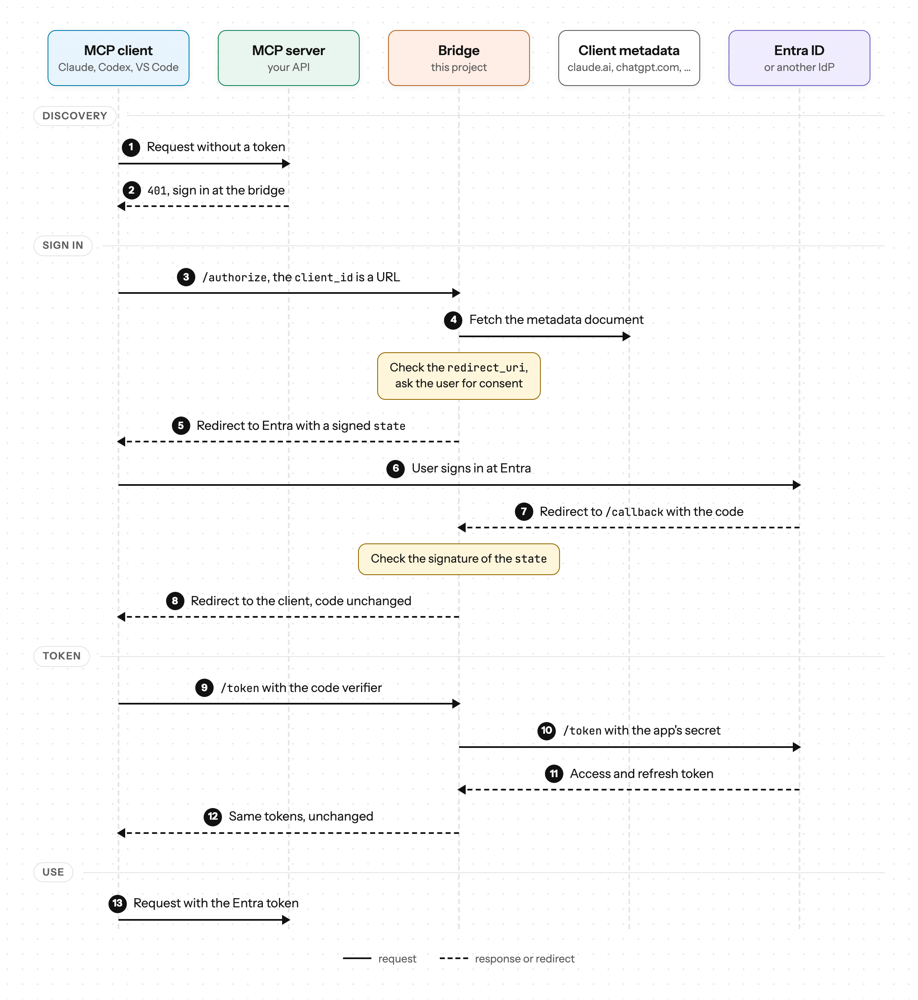

# entra-cimd-bridge

MCP clients like Claude, Codex or VS Code want to connect to an MCP server without registering a client first. The [MCP authorization spec](https://modelcontextprotocol.io/specification/2025-11-25/basic/authorization) does this with Client ID Metadata Documents (CIMD): the `client_id` is a URL to a JSON document that describes the client. Entra ID doesn't support this, so you would have to register an app registration for each MCP client. Entra also rejects the `resource` parameter (RFC 8707) that MCP clients send, if it doesn't match the requested scopes (`AADSTS9010010`).

CIMD isn't a "hacky" solution, other IdPs like [Pocket ID](https://pocket-id.org/docs/guides/client-id-metadata-documents) and [Auth0](https://auth0.com/docs/get-started/auth0-overview/create-applications/register-applications-with-cimd) already support it. If your IdP does, you don't need this bridge.

The bridge sits in front of Entra ID (or another OIDC provider) and is the authorization server for the MCP clients. For Entra it's a normal confidential client, with one app registration per MCP server. The bridge uses the `resource` of the client to pick the app registration and scopes of the MCP server and doesn't send it to Entra. Codes and tokens come from Entra and are passed through unchanged, so your MCP servers validate Entra tokens like before.

The bridge has no database, doesn't issue its own tokens and doesn't proxy any MCP traffic.

## How it works

If you want to understand the flow, here's a diagram showing how the bridge interacts with the MCP client and Entra ID.

<picture>
  <source media="(prefers-color-scheme: dark)" srcset="docs/flow-dark.png">
  
</picture>

## Running

The image is `ghcr.io/natrontech/entra-cimd-bridge`:

```sh
docker run -p 8080:8080 -v ./config.yaml:/etc/bridge/config.yaml:ro \
  -e BRIDGE_KEY_CURRENT="$(openssl rand -base64 48)" \
  -e ENTRA_TENANT_ID=… -e CONTACTR_CLIENT_ID=… -e CONTACTR_CLIENT_SECRET=… \
  ghcr.io/natrontech/entra-cimd-bridge:latest
```

Or with the Helm chart. The config goes under `config:` in the values, and the secrets into a Secret set in `existingSecret`. Its keys become environment variables.

```sh
helm install entra-cimd-bridge oci://ghcr.io/natrontech/charts/entra-cimd-bridge --values values.yaml
```

Replicas only share the signing keys, so you can run as many as you want.

`bridge --config config.yaml --check` validates the config, runs the OIDC discovery for every provider and exits.

## Configuration

See [`config.example.yaml`](config.example.yaml) for a full example. `${NAME}` in a value is replaced with the environment variable. If the variable isn't set, the bridge doesn't start.

| Key                        |                                                                                                                                                                                                                                                                    |
| -------------------------- | ------------------------------------------------------------------------------------------------------------------------------------------------------------------------------------------------------------------------------------------------------------------ |
| `issuer`                   | Public URL of the bridge, an https origin without a path. For local development `http://localhost:<port>` works too                                                                                                                                                |
| `listen`, `metrics_listen` | Default `:8080` and `:9090`. `/metrics` has its own listener so it isn't exposed to the internet                                                                                                                                                                   |
| `signing_keys`             | Keys with at least 32 bytes, used for the state and the consent cookie. The first key signs, all keys verify. To rotate, add a new key at the top and remove the old one after `consent_ttl`                                                                       |
| `providers.<name>.issuer`  | The issuer of the IdP, loaded with OIDC discovery at startup. Providers that list `code_challenge_methods_supported` without `S256` are refused (Entra lists nothing but supports S256)                                                                            |
| `clients.cimd_hosts`       | Hosts that can serve client metadata documents: a host, `*.domain` or `*`. Claude uses `claude.ai`, Codex `chatgpt.com` and VS Code `vscode.dev`. If you remove a host, new sign-ins stop, but existing refresh tokens keep working until you revoke them in Entra |
| `consent_ttl`              | How long the consent is remembered per client and MCP server, `0` asks every time                                                                                                                                                                                  |
| `resources`                | One entry per MCP server with its `uri`, a `name` for the consent page, the `provider`, the `client_id` and `client_secret` of its app registration and the `scopes` to request                                                                                    |

The `scope` the client sends is ignored, the bridge always requests the scopes from the config.

## Adding an MCP server

### In Entra

Use the app registration of the MCP server itself (Entra allows an app to request tokens for its own API), or create a separate one that only has permissions on the MCP server's API. Then:

1. Add `https://<bridge>/callback` as a **Web** redirect URI.
2. Create a client secret for the bridge.
3. Make sure the delegated scope, e.g. `api://<client-id>/access_as_user`, has admin consent and `requestedAccessTokenVersion` is 2.

Add the client ID and secret to `resources` in the config.

### In the MCP server

The MCP server validates the Entra tokens like before (issuer, audience and scope), the bridge doesn't change anything there. It only has to tell the clients where to sign in, with two things:

1. The Protected Resource Metadata (RFC 9728) at `/.well-known/oauth-protected-resource` followed by the path of the MCP server, with the bridge as authorization server:

   ```json
   {
     "resource": "https://contactr.natron.ch/mcp",
     "authorization_servers": ["https://mcp-auth.natron.ch"],
     "scopes_supported": ["api://<client-id>/access_as_user"]
   }
   ```

2. A 401 with a `WWW-Authenticate` header that points to this metadata, if a request has no valid token:

   ```
   WWW-Authenticate: Bearer resource_metadata="https://contactr.natron.ch/.well-known/oauth-protected-resource/mcp", scope="api://<client-id>/access_as_user"
   ```

Many MCP SDKs can already do this, so you don't need anything from this repo. For Go there is the small package [`resource`](resource/resource.go) that does both:

```go
import "github.com/natrontech/entra-cimd-bridge/resource"

meta := &resource.Metadata{
	Resource:             "https://contactr.natron.ch/mcp", // exactly as in the bridge's config
	AuthorizationServers: []string{"https://mcp-auth.natron.ch"},
	ScopesSupported:      []string{"api://<client-id>/access_as_user"},
}
mux.Handle("GET "+meta.Path(), meta) // /.well-known/oauth-protected-resource/mcp

// In front of the MCP handler
token, ok := resource.BearerToken(r)
if !ok {
	meta.Challenge(w) // 401 with resource_metadata and scope
	return
}
if err := verifyEntraToken(r.Context(), token); err != nil {
	meta.InvalidToken(w, "The access token is invalid or expired.")
	return
}
```

## Development

```sh
make test   # unit and end-to-end tests
make lint   # golangci-lint 2.14 or newer
make run    # runs with ./config.yaml
```
